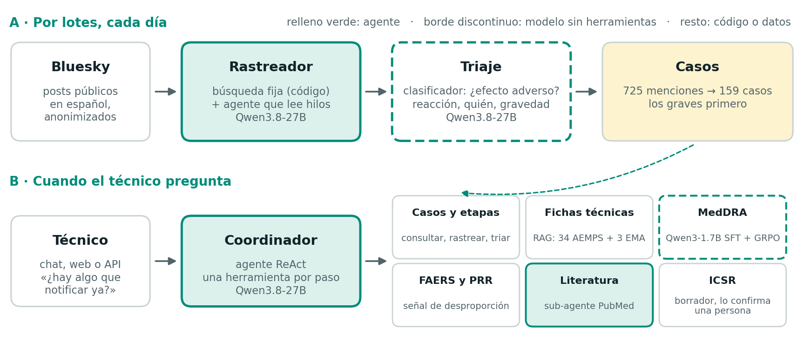
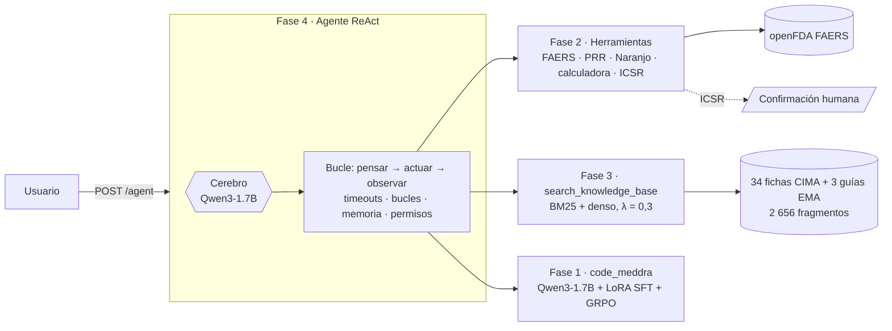

# PV-Agents · Farmacovigilancia en redes sociales con un sistema multiagente

Lo que la gente cuenta en Bluesky sobre sus medicamentos, convertido en casos que un técnico de
farmacovigilancia puede revisar con sus fuentes de siempre: ficha técnica, MedDRA, FAERS y
literatura. Los agentes hacen la parte pesada; las decisiones las toma una persona.

Proyecto final de Modelos Generativos Profundos · Máster en Inteligencia Artificial · ICAI ·
noviembre de 2026 · Mario, Matteo y Pedro.

| Entregable | Dónde |
|---|---|
| Landing page | [marioalonsoalonso.github.io/pv-agents](https://marioalonsoalonso.github.io/pv-agents/) · fuente en [`docs/index.html`](docs/index.html) (un solo fichero; se abre con doble clic) |
| Informe (3 páginas) | [`docs/informe_pv_agents.docx`](docs/informe_pv_agents.docx) |
| Presentación (12 diapositivas, con notas del orador) | [`docs/presentacion_pv_agents.pptx`](docs/presentacion_pv_agents.pptx) |
| Cuaderno de experimentos, fechado | [`EXPERIMENTS.md`](EXPERIMENTS.md) |
| Cómo trabaja el equipo (ramas, datos privados) | [`COLABORAR.md`](COLABORAR.md) |

## El problema

Las reacciones adversas se notifican poco: mucha gente no rellena la tarjeta amarilla, pero sí
lo cuenta en redes («llevo una semana con sertralina y no pego ojo»). Aprovecharlo exige tres
cosas: **encontrar** los posts del fármaco, también las respuestas que no lo nombran («a mí
también me pasó»); **separar** los efectos adversos de las bromas, preguntas, opiniones y
noticias, extrayendo el caso; y **valorar** cada caso con las fuentes del técnico.

## Arquitectura



| Pieza | Qué es | Modelo | Carpeta |
|---|---|---|---|
| Rastreador | Código (búsqueda fija por nombres, marcas, erratas y jerga) + un agente que lee las conversaciones y guarda las respuestas que hablan del fármaco | Qwen3.8-27B (servidor del curso) | [`crawler/`](crawler/README.md) |
| Triaje | Clasificador con LLM, una llamada por post: ¿efecto adverso?, reacciones con las palabras del paciente, quién, sexo, gravedad, desenlace. El código valida cada respuesta | Qwen3.8-27B | [`triage/`](triage/README.md) |
| Coordinador | Agente ReAct (una acción por paso) que responde al técnico con unas 20 herramientas y cita la fuente de cada dato; el ICSR y los trabajos grandes esperan confirmación humana | Qwen3.8-27B | [`coordinator/`](coordinator/README.md) |
| Literatura | Sub-agente que busca en PubMed y resume con referencias comprobadas | Qwen3.8-27B | [`crawler/`](crawler/README.md) |
| Codificador MedDRA | Modelo de razonamiento: texto del paciente → *Preferred Terms*, con las reglas de MedDRA | Qwen3-1.7B + LoRA (SFT + GRPO), entrenado por nosotros | [`rlm/`](rlm/) |
| Fichas técnicas | RAG híbrido (BM25 + denso) sobre 34 fichas de CIMA y 3 guías de la EMA | Qwen3-Embedding-0.6B | [`rag/`](rag/) |
| FAERS, PRR, ICSR | Herramientas en código (openFDA en vivo, regla de Evans, validación del ICSR) | — | [`tool_use/`](tool_use/) |

Dos momentos: **por lotes**, el rastreador y el triaje convierten los posts en casos (los graves
primero); **a petición**, el coordinador trabaja sobre esos casos y puede consultar cualquier
etapa o lanzar un rastreo o un triaje nuevo. Lo que se puede garantizar en el código (texto
copiado de la fuente, hilos leídos, cifras y citas con respaldo, nombres de fármacos que no
existen, ICSR válidos) se comprueba en el código, no se pide en el prompt.

## Resultados

Cada pieza se ajustó en desarrollo y se midió **una sola vez** en un examen separado, siempre
frente a la alternativa sencilla. Intervalos de Wilson al 95 % y McNemar entre sistemas.

| Pieza | Medida (examen) | Nuestro sistema | Alternativa |
|---|---|---|---|
| Rastreador | Menciones encontradas (66 en 567 posts anotados) | **98 %** (híbrido v5), 19 de 19 indirectas | 70 % búsqueda fija, 0 de 19 · 91 % un agente que lo hace todo, con el doble de tokens |
| Triaje | Efectos adversos detectados · precisión (438 menciones) | **79 %** [69–86] · **80 %** [70–87] (83 % con el rastreador v5) | 46 % · 51 % con palabras clave |
| Codificador MedDRA | Conjunto exacto de *Preferred Terms* (200 notificaciones) | **56,5 %** el 1,7B entrenado (18,5 % sin entrenar) | Qwen3.8-27B: 46 %, 67,5 % perdonando el formato; 74 % frente a 38 % en términos nunca vistos |
| Coordinador | Peticiones de técnico bien resueltas (59) | **54 / 59** (92 %) | Sin RAG 30 (p < 0,0001) · sin MedDRA 52 · sin literatura 51 |
| Coordinador | Preguntas generales · nombres raros y comparativas · etapas | **27 / 27** · **11 / 13** · **14 / 14** | — · 8 / 13 sin las herramientas de nombres · 2 / 14 sin las de etapas |
| Literatura | Referencias de PubMed inventadas | **0 / 86** | — |

Coste típico del coordinador: unos 7 s y 18 000 tokens por pregunta. El detalle, los fallos y
las correcciones de la medida están en [`EXPERIMENTS.md`](EXPERIMENTS.md) y en el README de cada
carpeta; las cifras, sin texto de ningún post, en [`reports/`](reports/).

## Cómo ejecutarlo

Requisitos: Python 3.11–3.12, [`uv`](https://docs.astral.sh/uv/), y para el sistema completo
una sesión de la DGX (el 27B del curso solo se alcanza desde dentro, y el codificador MedDRA y
el buscador del RAG usan la GPU).

```bash
git clone https://github.com/MarioAlonsoAlonso/pv-agents && cd pv-agents
cp .env.example .env          # ARCA_REMOTE_LLM_URL y ARCA_REMOTE_LLM_API_KEY: el 27B del curso
make setup                    # = uv sync --extra train --extra rag --extra agent --extra crawler
make test                     # los tests no necesitan red, GPU ni data/
make rag-corpus               # fichas de CIMA y guías de la EMA (~10 min, una vez)
```

Usar el sistema (en la DGX):

```bash
make coordinador-chat         # conversación con el coordinador en la terminal
make coordinador-web          # la misma conversación en una página, en http://127.0.0.1:7860
                              # (desde tu ordenador: ssh -L 7860:localhost:7860 <usuario>@<dgx>)
make coordinador-casos        # resumen de los casos, sin modelo
make crawler-vigilar-triar    # rastrea lo nuevo en Bluesky y lo pasa por el triaje
```

Preguntas para empezar: «Dame una visión general de lo que tenemos», «¿Hay señal de rotura de
tendón con el ciprofloxacino?», «¿Qué dice la ficha técnica del pantoxazol sobre el embarazo?»
(un nombre que no existe: pregunta si es el pantoprazol) y «Envía ya a la AEMPS el ICSR del caso
grave» (no lo envía: lo deja para que lo confirme una persona).

Reproducir las evaluaciones:

| Pieza | Desarrollo | Examen (una vez) |
|---|---|---|
| Rastreador | `make crawler-eval` | ver [`crawler/README.md`](crawler/README.md) |
| Triaje | `make triage-base`, `make triage-dev` | `make triage-examen` |
| Codificador MedDRA | `make rlm-data rlm-distill rlm-sft rlm-grpo` | `make rlm-eval rlm-ablations`; el 27B: `uv run python -m rlm.evaluate_remote` |
| Coordinador | `uv run python -m coordinator.evaluate --bench coordinator/bench/tareas_v2.jsonl --conjunto dev` | lo mismo con `--conjunto test`; etapas: `make coordinador-examen-etapas` |
| Validaciones sin GPU | `uv run python -m rlm.term_pr` · `uv run python -m triage.regla_revision` | — |

## Datos y privacidad

Los posts son de personas reales. Todo lo que contiene su texto (la muestra de Bluesky, las
hojas de soluciones, las respuestas del triaje y del coordinador) vive en `data/`, que **no está
en git**: para reproducir las cifras hay que pedírselo al equipo por un canal privado
([`COLABORAR.md`](COLABORAR.md)). Los posts se anonimizan (usuarios, enlaces, correos) y en
`reports/` solo hay cifras. La clave del 27B va en `.env`, que tampoco está en git.

## Estructura

```
crawler/            rastreador de Bluesky (búsqueda fija + agente), vigilante y sub-agente de literatura
triage/             triaje: prompts v0–v3p, validación de cada respuesta, evaluación por lotes
coordinator/        coordinador: herramientas, etapas, avisos en el código, bancos v1–v5, chat y web
evaluacion_triaje/  guía de anotación y herramientas de la hoja de soluciones del triaje
common/             catálogo de fármacos, rutas de data/, estadística y clientes de los modelos
rlm/                codificador MedDRA: dataset, verificador, destilación, SFT, GRPO, evaluación, el 27B
rag/                corpus de fichas técnicas y guías, troceado, retrievers, generación con citas
tool_use/           FAERS, PRR, Naranjo, ICSR y el registro de herramientas
agent/              bucle ReAct de las prácticas, sobre el que corren el rastreador y el coordinador
api/                API FastAPI de las prácticas (/reasoning, /tools, /rag, /agent)
docs/               landing, informe, presentación, diagrama, enunciados y guías
reports/            cifras de todas las evaluaciones (JSON y PNG, sin texto de posts)
scripts/            sesiones de la DGX
tests/              tests de todo lo anterior
```

## La base: ARCA, las prácticas del cuatrimestre

El sistema se construyó sobre ARCA, el agente de las cuatro prácticas (codificador MedDRA,
herramientas, RAG y agente ReAct). Su documentación se conserva aquí.

### ARCA · Agente de farmacovigilancia

**Un agente que codifica notificaciones de reacciones adversas en MedDRA, consulta fichas técnicas
y datos de FAERS, calcula señales de desproporcionalidad y prepara el ICSR, con un humano que
confirma antes de registrar nada.**

Práctica final de Modelos Generativos Profundos · Máster en Inteligencia Artificial · ICAI ·
2026-2027. Todo con modelos abiertos pequeños (Qwen3-1.7B) entrenados y evaluados en una GPU de
16 GB. El enunciado de la práctica está en [`docs/practica.md`](docs/practica.md).

### Para quién y qué problema resuelve

Un técnico de farmacovigilancia de un centro autonómico recibe notificaciones en lenguaje
natural ("llevo una semana con sertralina y me da muchísimo sueño") y tiene que:

1. **Codificarlas** en *Preferred Terms* de MedDRA aplicando las reglas de *Term Selection: Points
   to Consider* (lo negado no se codifica, el diagnóstico absorbe sus síntomas, la muerte es un
   desenlace…).
2. **Comprobar** en la ficha técnica si la reacción es conocida y con qué frecuencia.
3. **Mirar** cuántas notificaciones hay en FAERS y si hay señal (PRR, regla de Evans).
4. **Valorar** la causalidad (algoritmo de Naranjo) y **registrar** el caso (ICSR).

Hoy eso son cuatro pestañas, un diccionario con licencia y una hoja de cálculo. ARCA lo resuelve
en una petición, y deja el registro pendiente de que una persona lo confirme.

### Ejemplo real (agente, cerebro `base`, del banco de evaluación)

> *Mira en la ficha técnica si el edema periférico es una reacción conocida del amlodipino y
> calcula su PRR en FAERS.*

| Paso | Acción | Observación (real) |
|---|---|---|
| 1 | `search_knowledge_base("Is peripheral edema a known adverse reaction of amlodipine?")` | `[1d381329ee-0023]` Ficha técnica de amlodipino, 4.8 Reacciones adversas … |
| 2 | `faers_reaction_counts(drug="amlodipino", reaction="Oedema peripheral")` | 8 358 notificaciones con el fármaco y la reacción, de 434 733 con amlodipino (openFDA) |
| 3 | `disproportionality_prr(8358, 434733, 122014, 21054159)` | PRR 3,49 (IC 95 % 3,41–3,57), **señal** según Evans |
| 4 | `final_answer(…)` | "El PRR del edema periférico con amlodipino en FAERS es 3,49 … señal significativa" |

El agente normaliza "amlodipino" a "amlodipine", copia los recuentos de FAERS al PRR sin
tocarlos y no inventa ningún número. La traza completa (pensamientos incluidos) la devuelve
`POST /agent`, y `uv run python -m agent.ui` la muestra en un visor.

### Arquitectura



| Fase | Qué es | Endpoint | Carpeta |
|---|---|---|---|
| 1 · Razonamiento | Codificación MedDRA: destilación de Qwen3-4B → SFT → GRPO con tres recompensas verificables, sobre Qwen3-1.7B con LoRA | `POST /reasoning` | [`rlm/`](rlm/) |
| 2 · Herramientas | 5 herramientas tipadas con Pydantic (FAERS en vivo, PRR, Naranjo, calculadora segura, ICSR con confirmación) y el bucle de tool use escrito a mano | `POST /tools` | [`tool_use/`](tool_use/) |
| 3 · Conocimiento | RAG sobre fichas técnicas de CIMA y guías de la EMA: troceado recursivo, BM25, Qwen3-Embedding-0.6B, híbrido y respuestas con citas verificadas | `POST /rag` | [`rag/`](rag/) |
| 4 · Agente | Harness ReAct propio: una acción por paso, timeouts, recuperación de errores, detección de bucles, memoria con resumen, confirmación humana, tres cerebros intercambiables; y un agente de código (smolagents) para comparar | `POST /agent` | [`agent/`](agent/) |

Decisiones y alternativas descartadas, fase a fase, en la [guía del proyecto](docs/guia/README.md).

### Resultados

Todas las cifras son de conjuntos de **test** que no se usaron para tomar decisiones.

**Fase 1 · Codificación MedDRA** (pass@1 = conjunto exacto de PT, decodificación greedy)

| Modelo (Qwen3-1.7B) | Test (200) | Fuera de distribución (100, términos nunca vistos) |
|---|---|---|
| Base | 18,5 % | 14 % |
| + SFT (821 trazas destiladas y verificadas) | 51,5 % | 30 % |
| **+ SFT + GRPO** | **56,5 %** | **38 %** |

Ablaciones de GRPO: sin la recompensa de dominio, 53,0 %; con crédito parcial (F1), 55,0 %.
McNemar: SFT frente a base, p < 0,001; GRPO frente a SFT, p = 0,11 (tendencia, no significativo con 200
problemas). Detalle en [`rlm/RESULTADOS.md`](rlm/RESULTADOS.md).

**Fase 2 · Herramientas** (30 casos): selección de herramienta 1,00 · argumentos 0,83 ·
respuesta correcta **0,67 con herramientas frente a 0,33 sin ellas** · 6/6 preguntas que no
necesitan herramienta respondidas sin llamar a ninguna. [`tool_use/RESULTADOS.md`](tool_use/RESULTADOS.md)

**Fase 3 · RAG** (100 preguntas de test)

| Retriever | Hit@5 | MRR |
|---|---|---|
| BM25 | 0,66 | 0,530 |
| Denso | **0,90** | 0,684 |
| **Híbrido (λ = 0,3)** | 0,86 | **0,716** |

Generación con citas (Qwen3-1.7B): 68 % de respuestas citadas y 15 % de abstenciones falsas. Con
Qwen3-4B como generador, sobre la misma recuperación, 97 % y 3 %, y se abstiene en las 8 preguntas
sin respuesta: el cuello de botella era el generador. [`rag/RESULTADOS.md`](rag/RESULTADOS.md)

**Fase 4 · Agente** (20 tareas que encadenan de 2 a 3 herramientas, 2 de ellas imposibles)

| Agente | Cerebro | Éxito | Tokens por tarea |
|---|---|---|---|
| ReAct (JSON) | `base` | **55 %** | 11 550 |
| ReAct (JSON) | `thinking` | **55 %** | 11 127 |
| ReAct (JSON) | `rlm` (LoRA de la fase 1) | 10 % | 3 152 |
| Código (smolagents) | `thinking` / `base` | 35 % / 40 % | ~30 000 |

El modelo de la fase 1 como cerebro olvida el protocolo de herramientas (escribe la traza entera
con observaciones inventadas), así que entra en el agente como herramienta. El agente de código
gana en las tareas de cálculo, pero gasta casi el triple de tokens y pierde en el resto.
[`agent/RESULTADOS.md`](agent/RESULTADOS.md)

Lo que no funciona, sin adornos: **las tareas imposibles** ("¿cuántas notificaciones hubo en
España en 2025?" → da el total mundial de FAERS) fallan con todos los cerebros, y con 20 tareas
el ruido es de unos ±20 puntos. El cuaderno completo, fechado, está en [`EXPERIMENTS.md`](EXPERIMENTS.md).

### Cómo ejecutar ARCA (la API de las prácticas)

Requisitos: Python 3.11, [`uv`](https://docs.astral.sh/uv/) y una GPU NVIDIA con ≥ 12 GB para
servir las cuatro fases a la vez (en 8 GB caben de una en una).

```bash
git clone <este repositorio> && cd dgm-arca
cp .env.example .env              # el adaptador de la fase 1 se descarga del Hub
uv sync --extra train --extra rag --extra agent
uv run pytest                     # tests en verde
uv run python -m rag.download_corpus   # corpus: fichas de CIMA y guías de la EMA (~10 min)
uv run arca-api                   # http://localhost:8000/docs
```

Con Docker (driver de NVIDIA y `nvidia-container-toolkit` en la máquina):

```bash
cp .env.example .env
docker compose up api             # http://localhost:8000/docs
```

Si el corpus no está descargado, `/rag` lo descarga la primera vez que se le llama. El adaptador
LoRA de la fase 1 está en Hugging Face Hub:
[`Matteofermar/arca-meddra-qwen3-1.7b`](https://huggingface.co/Matteofermar/arca-meddra-qwen3-1.7b).

Peticiones de ejemplo:

```bash
curl -s localhost:8000/health
curl -s localhost:8000/reasoning -H 'Content-Type: application/json' \
  -d '{"question": "Llevo dos semanas con sertralina y me da muchísimo sueño. No he tenido náuseas."}'
curl -s localhost:8000/rag -H 'Content-Type: application/json' \
  -d '{"question": "¿Con qué frecuencia produce somnolencia la sertralina?", "retriever": "hybrid"}'
curl -s localhost:8000/agent -H 'Content-Type: application/json' \
  -d '{"task": "¿Hay señal de somnolencia con sertralina en FAERS? Calcula el PRR.", "brain": "base"}'
```

### Reproducir los resultados de las prácticas

| Fase | Comandos | Dónde |
|---|---|---|
| 1 | `make rlm-data rlm-distill rlm-sft rlm-grpo rlm-eval rlm-ablations` | GPU de 16 GB (DGX) |
| 2 | `make tools-eval` | GPU |
| 3 | `make rag-corpus rag-eval-gen` (desarrollo) y `make rag-test` (test, una sola vez) | GPU |
| 4 | `make agent-eval` | GPU |
| Todo lo pesado en una sesión | `bash scripts/dgx_session.sh` | DGX |

Los pesos, el índice y el corpus no están en el repositorio: los scripts anteriores los regeneran
(y el adaptador final está en el Hub). Los informes JSON y las gráficas de cada evaluación están en
[`reports/`](reports/).

## Licencia y datos

Código bajo licencia MIT. MedDRA es una terminología con licencia de la MSSO: el repositorio solo
incluye un subconjunto propio de 90 PT con fines docentes y un cargador para los ficheros
oficiales (`ARCA_MEDDRA_DIR`). Las fichas técnicas proceden de CIMA (AEMPS) y las guías de la EMA
se reproducen citando su origen; ninguna se redistribuye en el repositorio. FAERS se consulta en
vivo a través de openFDA.
